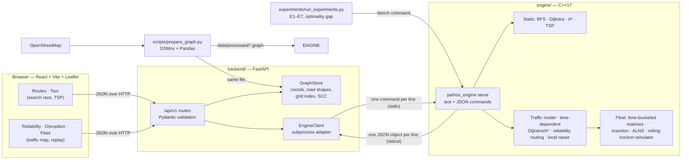
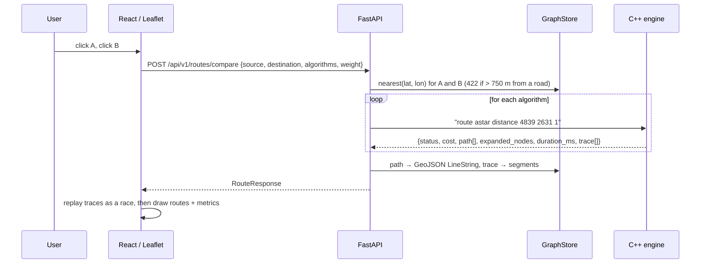
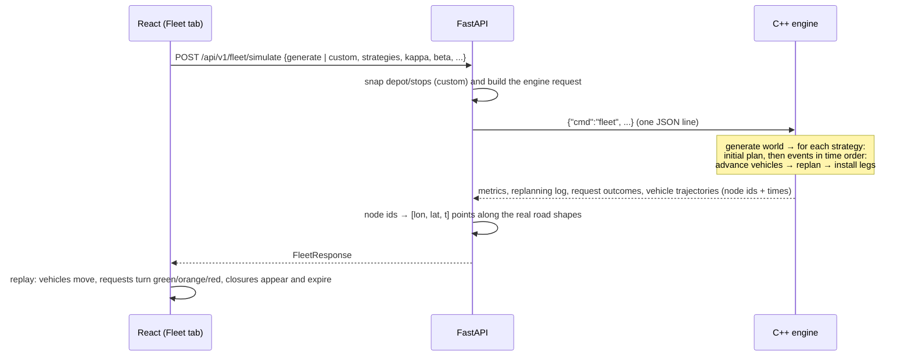
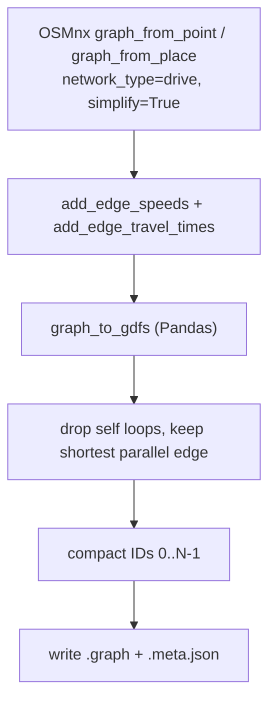
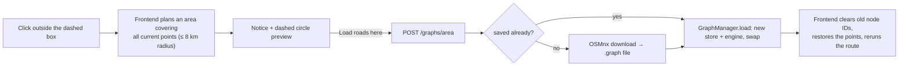

# Architecture

pathos started as an interactive routing and multi-stop tour (TSP) visualizer on real OpenStreetMap
roads (BFS, Dijkstra, A\*, nearest neighbour + 2-opt). **Pathos 2.0** turns it into an adaptive,
uncertainty-aware urban mobility optimiser: time-dependent traffic, random travel times, road
closures and accidents, multi-vehicle routing with time windows and capacities, and a rolling-horizon
simulator that compares replanning strategies. The original proposal is in [`INITIAL_ARCHITECTURE.md`](INITIAL_ARCHITECTURE.md).

This document describes the system **as implemented**; the differences from the plans are listed in
section 15. Measured results are in [`docs/RESULTS.md`](docs/RESULTS.md).

## 1. System overview



| Layer | Location | Responsibility |
|---|---|---|
| Data preparation | `scripts/` | Download roads with OSMnx, keep one-way restrictions, add length + free-flow travel time, assign compact IDs, export the graph file |
| Routing engine | `engine/` | Directed graph as an adjacency list; static algorithms; **traffic model, disruptions, time-dependent and uncertainty-aware routing, incremental repair, VRPTW/ALNS, replanning simulator, benchmarks** |
| API | `backend/` | Validate requests, snap coordinates to road nodes, call the engine, turn node IDs into GeoJSON geometry and timed trajectories, report errors |
| Frontend | `frontend/` | Map, point selection, five tabs (Routes, Tour, Reliability, Disruption, Fleet), congestion overlay, fleet replay |
| Experiments | `experiments/` | Reproducible runs of E1–E7 and the optimality gap; raw CSV/JSON + `docs/RESULTS.md` |

**Design rule:** all graph and optimisation algorithms run in C++. Python only validates, snaps and
formats; React only displays. The frontend never re-implements routing.

## 2. Mathematical model (as implemented)

| Problem statement | In the code |
|---|---|
| Time-dependent graph `G(t) = (V, E, W(t))` | `Graph` (static topology, free-flow length and time per edge) + `TrafficModel` + `Disruptions`; an edge time is a function of the entry time |
| Edge time `T_e(t, ω)` | `tau_e(t) = free_e · congestion_e(t) · incident_e(t)`; scenario ω multiplies it by a lognormal factor with mean 1 (section 4) |
| Road closure = unavailable edge | A closure is an interval in which the edge cannot be *entered*; the vehicle waits at its tail until it reopens (FIFO preserved) |
| Chance constraint `P(T ≤ D) ≥ 1 − α` | Estimated on `M` shared scenarios; the reliability-constrained route is the fastest candidate that satisfies it (section 5) |
| Multi-objective `J` | `J = w_time·time + w_dist·dist + w_energy·kWh + w_late·lateness + w_risk·risk (+ w_wait·wait + vehicle fixed cost + unassigned penalty)` |
| Replanning objective `J_replan = C_new + β C_disruption + γ C_comp` | Route cost + `β ·` *schedule disruption* (moved / reordered stops) inside the ALNS objective; computation cost `γ` is **measured** (replanning latency) rather than folded into the objective |
| VRP / VRPTW constraints | Capacity, hard time windows (soft with `max_late_s`), service times, shift end, return to depot, road accessibility (closures, one-way) |

**Fleet model ("pick-up and return"):** each request must be visited by one vehicle inside its time
window, adds `demand` to the vehicle's load (≤ capacity), takes `service_s`, and every vehicle must
be back at its depot before its shift ends. Requests that cannot be served feasibly stay
*unassigned* and cost `unassigned_penalty`.

**Energy and risk** are simple proxies, not vehicle-physics models: energy = distance × 0.15 kWh/km
× (1 + 0.6 × load / capacity); risk of a stop = clamp(1 − slack / 300 s, 0, 1), where slack is the
time left before the window closes.

## 3. Request lifecycle

Classic route comparison (unchanged):



A Pathos 2.0 fleet simulation:



## 4. C++ engine

```
engine/
├── include/pathos/
│   ├── types.hpp       Node, Edge, Weight, Algorithm, SearchEvent, RouteResult
│   ├── graph.hpp       Graph (adjacency list), haversine, admissible heuristic
│   ├── routing.hpp     static bfs / dijkstra / astar / dijkstra_to_targets
│   ├── tsp.hpp         Matrix, nearest_neighbor_tour, two_opt, held_karp, solve_tour
│   ├── traffic.hpp     TrafficModel, Disruptions, EvalMode, Net            (2.0)
│   ├── tdroute.hpp     time-dependent search, reliability routing, local repair  (2.0)
│   ├── fleet.hpp       TdMatrix, Problem, route evaluation, insertion, ALNS     (2.0)
│   ├── sim.hpp         world generator, rolling-horizon simulator, strategies    (2.0)
│   ├── commands.hpp    JSON command layer; jsonparse.hpp: request parser         (2.0)
│   └── json.hpp        dependency-free JSON writer
├── src/                graph path bfs dijkstra astar tsp · traffic tdroute fleet sim commands bench · main
├── tests/test_engine.cpp
├── CMakeLists.txt
└── build.sh            CMake if available, otherwise plain c++
```

### 4.1 Static layer (unchanged)

| Structure | Purpose |
|---|---|
| `std::vector<Node>` / `std::vector<std::vector<Edge>>` | Node table and **adjacency list** of outgoing directed edges (`to`, `length_m`, `time_s`) |
| `std::queue`, `std::priority_queue` | BFS frontier; Dijkstra / A\* binary min-heap with lazy deletion |
| `parent[]`, `dist[]`, `settled[]` | Path reconstruction, best known cost, closed set |
| `Matrix` (k × k), `dp[2^k][k]` | Tour distance matrix (asymmetric), Held–Karp exact tour for k ≤ 12 |

| Algorithm | Objective | Complexity |
|---|---|---|
| BFS | fewest road segments | O(V + E) |
| Dijkstra | min Σ weight | O((V + E) log V) |
| A\* | min Σ weight, `h = 0.999 × haversine` (÷ v_max for time) | same worst case, far fewer expansions |
| Nearest neighbour + 2-opt | tour construction / improvement, asymmetric costs via prefix sums | O(k²) per pass |
| Held–Karp | exact tour, k ≤ 12 | O(2^k k²) |

### 4.2 Traffic, uncertainty and disruptions (`traffic.hpp`)

**Expected time.** `tau_e(t) = free_e · (1 + I · s_e · p(t)) · incident_e(t)`.

- `p(t)` is a synthetic daily curve in [0, 1]: near zero at night, peaks of 1.0 at 08:00 and 18:00, a
  midday plateau of about 0.3. It is **not measured traffic**; every table and the UI label it as
  synthetic.
- `s_e` is the edge's sensitivity: `(0.15 + 1.15 · exp(−d_centre / R)) · class · jitter`, so the city
  centre and fast roads suffer most at peak and the outskirts barely change. `I` (default 1) scales
  the whole effect; `I = 0` gives the free-flow network.
- Congestion ramps are slow enough that **FIFO holds** (leaving later never means arriving earlier),
  which makes earliest-arrival Dijkstra correct. The unit tests verify FIFO numerically.

**Scenario time.** `T_e(t, ω) = tau_e(t) · exp(cv_e(t) · Z_e(ω) − cv_e(t)² / 2)`, a lognormal factor
with mean 1, so expected times stay expected. `cv_e(t) = base_cv · scale_district + cv_slope · (cong − 1)`:
variability grows with congestion and differs by district (some neighbourhoods are far less
predictable). `Z_e = 0.6 z_city + 0.5 z_district + 0.62 z_edge` is standard normal and **positively
correlated across edges**, so route times do not average out unrealistically. Scenarios are
deterministic functions of `(seed, scenario id)` (hash-based generators), so every routing policy can
be evaluated on identical *common random numbers* and experiments are reproducible.

**Disruptions** (`Disruptions`): per edge, a list of spans `[from, to)`. A *closure* makes the edge
unenterable inside the span (the vehicle waits at its tail, so a detour is chosen only if it beats
waiting); an *incident* multiplies the edge time by a factor (default 3–4×).

**`EvalMode`** selects how an edge time is computed: `freeflow` (the empty network, what a static
router sees), expected (default), robust `mean · (1 + κ cv)`, or one realised `scenario`.
**`Net`** bundles graph + traffic model + the disruptions *known to the planner*.

### 4.3 Time-dependent and uncertainty-aware routing (`tdroute.hpp`)

| Component | Method |
|---|---|
| `td_search` / `td_route` | Earliest-arrival Dijkstra and A\* on the time-dependent network. A\* uses the free-flow straight-line bound, which stays admissible because traffic only slows edges (it is disabled for sampled scenarios, which can be faster than the mean). Optional `targets` list for one-to-many searches |
| `reliability_routes` | Builds a candidate pool (free-flow, expected, robust with `κ = z(1−α)`, `κ ∈ {0.5, 1, 2, 3}`, and the optimal route of 12 sampled scenarios), evaluates **every** candidate on the same M scenarios (default 300, ids disjoint from the generating ones) and reports mean, std, p50, p95, worst and `P(T ≤ D)`. The *reliability-constrained* route is the fastest candidate with `P ≥ 1 − α`; if none qualifies the most reliable one is returned and `reliable_feasible = false` |
| `local_repair` | **Selective replanning of one vehicle** (below) |

The pool is a heuristic for the chance-constrained problem, not an exact solver: it can miss a route
that no mean-plus-κσ or scenario-optimal search generates.

**Local repair after a disruption.** Given the remaining route, the newly announced disruptions and
the current time:

1. Walk the route under the new network to get the arrival time at each node and find the *first* and
   *last* edges touched by a disruption that is still in force. If there are none, the route is kept
   (cost: one O(route length) scan, zero search).
2. Run a goal-directed search (A\* with key = arrival + straight-line bound to the destination) from a
   node up to `lookback` (default 5) edges *before* the first affected edge, so the detour can leave the
   route early. Every settled node that lies on the old route *after* the last affected edge is a rejoin
   candidate; its total is the arrival there plus the time-dependent remainder of the old route (skipped
   when the free-flow remainder already cannot beat the best total). The search stops as soon as the
   smallest key cannot beat the best total (an admissible bound), and the best splice is returned.
3. If no rejoin node is reachable it escalates to a full search from the vehicle's node.

Because the prefix and suffix of the old route are kept, the result is never worse than waiting at the
closure and never better than full recomputation (both are tested). `lookback` trades quality for search
size: 0 searches ~18 % fewer nodes than a full A\* but arrives 26–68 % later after a closure; 5 is within 1 %
of optimal and saves only ~6 %; ≥ 15 is identical to a full search (E4a in `docs/RESULTS.md`). For a *single*
vehicle on a few-thousand-node graph a full A\* costs ≈ 0.2 ms, so the real benefit of selectivity is at
fleet level (section 4.5), not here.

### 4.4 Multi-vehicle optimisation (`fleet.hpp`)

**Time-bucketed matrix (`TdMatrix`).** Travel time and distance between all relevant nodes (vehicle
positions, depots, requests) as a function of the departure time: one-to-many time-dependent
searches at up to 9 bucket times (at least every 30 min, horizon ≤ 6 h), linearly interpolated in
between. This costs `k · buckets` searches; with disruptions the waiting rule is built in, so a
closure shows up in the matrix. With `κ > 0` the matrix is built with robust edge times, which gives
every leg a safety buffer.

**Route evaluation** walks the stops once: arrival = departure + matrix time; wait for the window to
open; check capacity, window end (or `max_late_s`), and shift end including the trip back to the depot;
accumulate time, distance, energy, lateness, risk and waiting into the objective `J` of section 2.

**Construction.** Greedy or regret-2 insertion with a cache of the best insertion per (request,
vehicle), invalidated only for the vehicle that changed. Capacity is pre-checked; time feasibility is
checked by evaluating the whole modified route.

**ALNS** (`plan_problem`): destroy operators *random*, *worst* (largest cost saving), *Shaw/related*
(close in space, window and demand) and *route removal*; repair operators *greedy* and *regret-2*;
simulated-annealing acceptance with geometric cooling; operator weights adapted every 40 iterations
from rewards 33 / 9 / 13 (new best / better / accepted). It runs for a fixed iteration count (default
`30 ×` requests, so results are reproducible) and returns the best solution.

`PlanMode` selects the starting point: **Scratch** (complete recomputation), **Warm** (the previous
routes; used by selective replanning) and **InsertOnly** (keep everything, insert only the new
requests). Brute force over all assignments and orderings (`brute_force`, ≤ 8 requests) is used in
tests and in the optimality-gap experiment.

**Schedule disruption** of a new plan relative to the old one: 1 per request moved to another
vehicle, 0.5 per request that stays but changes order among the requests that stay (new requests do
not count). With weight `β` it is part of the ALNS objective for selective replanning.

### 4.5 Rolling-horizon simulation (`sim.hpp`)

A discrete-event loop executes the vehicles on the **real world** (all disruptions, one sampled
travel-time scenario) while the planner only knows what has been *announced* (disruptions are
announced when they start; the planner knows their end time). Events are late request arrivals and
disruptions. Vehicles move edge by edge; at an event time every vehicle is advanced to its next node
and the planner is given each vehicle's position and clock, so replanning starts from the true state.

| Strategy | On a new request | On a disruption |
|---|---|---|
| **Static** | cheapest insertion into the existing routes | ignored: vehicles keep their routes and wait at closures |
| **Greedy repair** | cheapest insertion | affected vehicles get new *paths* for the same stop order |
| **Full recomputation** | all vehicles, rebuilt from scratch (ALNS) | same |
| **Selective** (proposed) | the `k = 3` nearest vehicles' sub-problem, warm-started, ALNS with `β`; widened to the whole fleet if the request cannot be placed | only the vehicles whose remaining paths cross the disruption are re-optimised; nothing is done if none are |

Every strategy shares the same initial plan. Each replan is a `Problem` (some vehicles with their
current state and the requests they own plus waiting requests) → its own small `TdMatrix` → solve →
new legs for the vehicles that changed. Replanning latency (matrix + solve + legs) is measured with a
wall clock; schedule disruption, on-time rate, lateness, distance, energy and realised cost are
computed from what the vehicles actually did.

`evaluate_plan_mc` executes the **initial plan without replanning** under many sampled scenarios to
estimate its reliability (used for the reliability buffer `κ`).

`generate_world` builds reproducible scenarios: depot at the most central node that can reach most of
the map, requests on mutually reachable nodes, time windows placed relative to the travel time from
the depot, a configurable share of requests arriving late, and closures / accidents on the roads that
the most free-flow shortest paths from the depot share (the busy corridors, so they actually matter).

### 4.6 Process interface

```
pathos_engine <graph-file> serve          # long-running; prints {"ok":true,"ready":true,...}
pathos_engine <graph-file> <command...>   # single command, useful for debugging

info
route <bfs|dijkstra|astar> <distance|time> <source> <target> [trace 0|1]
tour  <distance|time> <stop1> <stop2> ... <stopK>
quit
{"cmd":"traffic","t_s":28800}                                  # congestion curve + congested edges at a time
{"cmd":"td_route","source":S,"target":T,"depart_s":28800,"slack":1.15,"alpha":0.1,"scenarios":300}
{"cmd":"replan_demo","source":S,"target":T,"type":"closure","duration_s":3600,"edges_ahead":10}
{"cmd":"fleet","generate":{...} | "vehicles":[..],"requests":[..],"auto":{..},"strategies":[..],"params":{..},"mc":{..}}
{"cmd":"bench","exp":"E4","seeds":5}                           # experiments, see section 11
```

A line that starts with `{` is a JSON command (parsed by the small reader in `jsonparse.hpp`);
anything else is a text command. The API keeps one engine process alive, so the graph is parsed once.
Calls are serialised with a lock; if the process crashes or does not answer within the timeout it is
restarted and the call retried once. Fleet simulations get a longer timeout
(`PATHOS_FLEET_TIMEOUT_S`, default 180 s).

## 4. Graph file format

Shared by the engine and the API (`scripts/graph_format.py`):

```
# comments
pathos-graph 1
version jaipur-v1
nodes N
<lat> <lon> <osm_id>                               # line i = node i
edges M
<u> <v> <length_m> <time_s> <k> [<lat> <lon>]*k    # directed u -> v; k road shape points
```

Shape points are used only for drawing curved roads; the engine skips them. A `<name>.meta.json`
sidecar stores the bbox, source query, OSMnx version and creation time so results can be tied to a
graph version.



`scripts/make_demo_graph.py` writes a synthetic city grid in the same format so the app works offline.

## 5. API layer

| Endpoint | Purpose |
|---|---|
| `POST /api/v1/routes` | One algorithm (`algorithm`, `weight`, `record_trace`) |
| `POST /api/v1/routes/compare` | Several algorithms on the same pair (default: all three) |
| `POST /api/v1/tours` | Multi-stop tour; first stop is start and end |
| `GET /api/v1/traffic?hour=8` | **2.0** Daily congestion curve (48 half-hours) and the congested roads at `hour`, in four levels (slow / heavy / severe / closed) as GeoJSON-style lines |
| `POST /api/v1/mobility/routes` | **2.0** Free-flow, expected, robust and reliability-constrained routes for one trip, each with expected time, mean / p95 / worst over scenarios and `P(on time)` for a deadline (`slack` × expected time) and `alpha` |
| `POST /api/v1/mobility/replan` | **2.0** One vehicle, one closure or accident ahead on its route: *keep the plan*, *full recomputation* and *selective local repair* — routes, arrival times, nodes searched, compute time |
| `POST /api/v1/fleet/simulate` | **2.0** A random scenario (`generate`) or a depot and stops chosen on the map (`custom`); runs the chosen strategies and returns metrics, replanning log, per-request outcomes and timed vehicle trajectories; optional Monte Carlo reliability of the initial plan |
| `GET /api/v1/graph/metadata` | Active graph: version, size, bbox, limits |
| `GET /api/v1/graphs` | Map areas saved in `data/processed` |
| `POST /api/v1/graphs/select` | Switch to a saved map area (`{"name": "jaipur-v1"}`) |
| `POST /api/v1/graphs/area` | Download roads around `center` or a `place` within `radius_m`, save and activate them |
| `GET /api/v1/health` | Engine liveness |
| `GET /docs` | Interactive OpenAPI docs |

`backend/app/routes/mobility.py` holds the 2.0 endpoints and `backend/app/schemas/mobility.py` their
models. They reuse the snapping and error handling of the 1.0 routes, so points outside the map give
the same structured `outside_coverage` error. Node-ID paths from the engine become GeoJSON through
`GraphStore.path_coordinates`; vehicle trajectories become `[lon, lat, seconds]` points through
`GraphStore.timed_path`, which interpolates times along curved road shapes by distance.

### Map areas (runtime graph switching)

`GraphManager` (`backend/app/services/graph_manager.py`) owns the active `GraphStore` + engine
pair. Switching builds the new store and starts a new engine process first, swaps them in under a
lock, and stops the old engine after a 30 s grace period, so in-flight requests finish on the graph
they started with. Each request takes one consistent snapshot of the pair.

`POST /graphs/area` calls `prepare_graph.build_graph()` (the same code as the CLI) to download a
circle of roads with OSMnx, writes `data/processed/<name>.graph`, and activates it. Names are
`area_<lat>_<lon>_<radius>m` or `<place-slug>-<radius>m`; an area that already exists is reused
without downloading. Only one download runs at a time (409 otherwise); the radius is capped at
`PATHOS_MAX_AREA_RADIUS_M` (8 km). Roads without a `maxspeed` tag get typical speeds per road type,
so rural areas with no speed tags still get travel times.



### Snapping

`GraphStore` indexes nodes in a uniform grid (~250 m cells) and searches rings of cells outward,
stopping once no closer node can exist. Points more than 750 m from any road are rejected with a
422 whose `detail` is structured:

```json
{ "code": "outside_coverage", "label": "source", "point": {"lat": 27.21063, "lon": 77.49784},
  "graph_version": "jaipur-v1", "distance_to_area_m": 169077,
  "message": "The source (27.21063, 77.49784) is about 169.1 km outside the loaded map area ('jaipur-v1'). Load the roads for this area first." }
```

The frontend uses it to offer loading that area instead of only showing an error. It also checks
clicks against the active bounding box before sending any request.

By default clicks only snap to nodes in the **largest strongly connected component**, computed at
start-up with an iterative **Kosaraju** algorithm (two DFS passes, O(V + E)). This guarantees that
any two snapped points are mutually reachable despite one-way streets. Set
`PATHOS_SNAP_MAIN_COMPONENT=0` to snap to any node instead; the engine then reports
`"status": "unreachable"` for impossible routes and lists unreachable tour legs explicitly (never as
zero-cost legs).

### Example

```json
POST /api/v1/routes/compare
{ "source": {"lat": 26.9124, "lon": 75.7873},
  "destination": {"lat": 26.9239, "lon": 75.8067},
  "algorithms": ["bfs", "dijkstra", "astar"], "weight": "distance", "record_trace": true }
```

Each result contains `status`, `cost`, `distance_m`, `time_s`, `segments`, `expanded_nodes`,
`duration_ms`, `route_node_ids`, a GeoJSON `geometry` (`[lon, lat]`), and `trace`: one
`[parent_lat, parent_lon, lat, lon]` entry per expanded node, in expansion order.

### Configuration (environment variables)

| Variable | Default |
|---|---|
| `PATHOS_GRAPH` | `data/processed/jaipur-v1.graph`, else `demo-v1.graph` |
| `PATHOS_ENGINE` | `engine/build/pathos_engine` |
| `PATHOS_MAX_TOUR_STOPS` | 25 |
| `PATHOS_MAX_SNAP_M` | 750 |
| `PATHOS_SNAP_MAIN_COMPONENT` | 1 |
| `PATHOS_ENGINE_TIMEOUT_S` | 30 |
| `PATHOS_MAX_TRACE_EVENTS` | 150 000 |
| `PATHOS_DATA_DIR` | `data/processed` |
| `PATHOS_OSM_CACHE` | `data/raw/osmnx-cache` |
| `PATHOS_MAX_AREA_RADIUS_M` | 8000 |
| `PATHOS_FLEET_TIMEOUT_S` | 180 |
| `PATHOS_MAX_FLEET_REQUESTS` | 120 |
| `PATHOS_MAX_FLEET_VEHICLES` | 20 |

## 6. Frontend

```
frontend/src/
├── api/            typed client + response types (mirror backend schemas)
├── map/            MapController (imperative Leaflet, named overlay layers), MapView
├── components/     RoutePanel, TourPanel                              (1.0)
│                   ReliablePanel, DisruptionPanel, FleetPanel,
│                   FleetPlayer, TrafficChart                          (2.0)
├── App.tsx         state, tabs, click routing, drawing
└── format.ts       units, clock, strategy colours
```

- **Routes / Tour:** as before (search race, tour with exact optimum and gap).
- **Reliability:** click A and B; choose departure time, deadline slack and α. The congestion layer
  for that hour is drawn on the map with the daily curve below it. The four routes are drawn stacked
  and tabulated with expected time, p95 and `P(on time)`; the insight lines show how wrong the
  free-flow estimate is and whether a route satisfying the chance constraint exists.
- **Disruption:** click A and B, choose closure or accident, duration and how far ahead it hits;
  compares keeping the plan, full recomputation and selective repair (trip time, delay, nodes
  searched, compute time).
- **Fleet:** a random scenario or a depot and stops placed on the map; choose strategies, `κ`, `β`.
  A table compares strategies (on-time %, unserved, late, distance, replanning time, schedule
  disruption, cost; best per column in green). Clicking a row **replays** that strategy: vehicles move
  on the roads, requests turn blue (waiting) → green (on time) / orange (late) / red (not served),
  closures and accidents appear and expire, and the replanning log lists each event with its latency.
- Panels own their points; `App` forwards map clicks to the active panel. Panels draw on named
  Leaflet layers (`MapController.layer(name)`) that are cleared when the tab or graph changes.
- The production build is served by FastAPI at `/`; in development Vite proxies `/api` to port 8000.

## 7. Error handling

| Scenario | Behaviour |
|---|---|
| Invalid coordinates / algorithm / weight / strategy | 422 from Pydantic |
| Point outside the loaded map | 422 `outside_coverage`; UI offers to download that area |
| Point inside the map but far from roads | 422 `outside_coverage` with `distance_to_area_m = 0`; shown as an error |
| Unknown place name | 404 |
| No drivable roads in the requested area | 422 |
| OpenStreetMap download fails / times out | 502; the current map stays active |
| Second download while one is running | 409 |
| Invalid saved-area name (e.g. `../x`) | 422; names are checked against `^[A-Za-z0-9][A-Za-z0-9_.-]*$` |
| Source = destination | `success`, zero cost, single-node path |
| Destination unreachable | `status: "unreachable"` (1.0 routes) / 422 (2.0 routes) |
| One-way restriction | Directed edges only; never traversed backwards |
| Unreachable tour stop | `status: "unreachable"`, `unreachable_legs` listed, red dashed leg in the UI |
| Too many / too few stops, fleet larger than the limits | 422 |
| `generate` and `custom` both (or neither) given | 422 |
| Request that cannot be served in time | not an error: it stays *unassigned* and is counted as unserved |
| Vehicle meets a closure it did not know about | waits until the road reopens (counted in its travel time) |
| Large trace | Capped (`trace_truncated: true`) |
| Engine crash / hang | Restart + one retry, then 503 and server-side log |

## 8. Testing

| Level | Command | Covers |
|---|---|---|
| Engine unit tests | `engine/build/pathos_tests` | **1.0:** known shortest paths, one-way edges, unreachable nodes, trace capping, Dijkstra = A\* on random queries, NN/2-opt, Held–Karp. **2.0:** JSON parser; congestion ≥ 1, night = free flow; **FIFO** for 400 random edges with closures and incidents; lognormal noise has mean 1, the right spread, positive correlation, determinism; normal quantile; time-dependent Dijkstra = A\* = a Bellman-Ford style reference on a 12×12 grid with closures; equals static Dijkstra when `I = 0`; closure detour vs waiting; reliability candidates (probabilities in [0, 1], quantile order, expected route is fastest in expectation, feasibility rule); local repair (≥ full-recompute optimum, ≤ waiting, valid path, no search when unaffected); ALNS feasibility and **gap to brute force** on tiny instances; schedule-disruption metric; simulator invariants for all four strategies (accounting, capacity, monotone clocks, trajectories follow edges, determinism, identical behaviour when nothing happens); JSON commands incl. malformed input |
| Sanitizers | `c++ -fsanitize=address,undefined …` (or `-DPATHOS_SANITIZE=ON`) | AddressSanitizer + UBSan on the unit tests (clean) |
| API integration | `cd backend && ../.venv/bin/pytest` | FastAPI → real engine subprocess: 1.0 routes, tours, snapping, areas; **2.0:** traffic map, reliability routes, replanning ordering (full ≤ selective ≤ static), fleet generate / custom, validation |
| Frontend | `cd frontend && npm run build` | TypeScript type-check + production build |
| Experiments | `python3 experiments/run_experiments.py` | E1–E7 and the optimality gap (section 11) |

## 9. Complexity summary

| Operation | Cost |
|---|---|
| Time-dependent Dijkstra / A\* | O((V + E) log V) per query; edge evaluation O(1) (O(spans) on disrupted edges) |
| Reliability routing | ≈ (candidates) searches + (candidates × M × route length) edge evaluations |
| Local repair | O(route length) scan + search limited to the region around the affected stretch |
| `TdMatrix` for k nodes, B buckets | k · B one-to-many searches |
| Route evaluation | O(stops) matrix look-ups |
| ALNS iteration | O(removed · vehicles · route length²) worst case, with the insertion cache |
| Simulation | events × (matrix + ALNS + legs) per strategy |

## 10. Repository layout

```
pathos/
├── engine/          C++ routing + optimisation engine (CMake) and unit tests
├── backend/         FastAPI app (app/main.py, routes/, schemas/, services/) + tests/
├── frontend/        React + Vite + TypeScript + Leaflet
├── experiments/     run_experiments.py, results/ (raw CSV + JSON), commentary.md
├── scripts/         prepare_graph.py (OSMnx), make_demo_graph.py, graph_format.py
├── data/processed/  versioned graph files (+ .meta.json); data/raw/ is the OSMnx cache
├── algos/           standalone reference implementations and notes used while designing the engine
├── docs/            proposal (pathos.pdf, pathos.md), RESULTS.md (generated)
└── run.sh           build everything and start the server
```

## 11. Experimental evaluation

`experiments/run_experiments.py` calls the engine's `bench` command and writes raw rows plus
`docs/RESULTS.md`. Every experiment is seeded; runtimes are wall-clock.

| Id | Comparison | Implementation |
|---|---|---|
| E1 | static vs time-dependent traffic | free-flow route evaluated in the time-dependent world vs the time-dependent optimum, at 03:00, 08:00, 13:00, 18:00 |
| E2 | deterministic vs stochastic | `P(on time)` of the free-flow, expected-time, robust and reliability-constrained routes for deadlines 5 / 15 / 30 % above the expected time |
| E3 | normal vs disrupted network | trip time with a 1 h closure or accident ahead: keep the plan vs full recomputation vs selective repair |
| E4 | full vs incremental replanning | (a) single vehicle: compute time, nodes searched and arrival gap; (b) fleet: static / greedy / full / selective plus ablations (`β = 0`, `β = 600`, `k = 2`) |
| E5 | single vs multiple vehicles | 1–8 vehicles on the same requests |
| E6 | expected vs reliability-aware | (a) α sweep for one trip; (b) fleet plans with buffer `κ` evaluated on sampled days |
| E7 | scalability | query times and expansions; matrix, ALNS time and memory for 10–80 requests |
| gap | optimality gap | ALNS vs brute force (7 requests, 2 vehicles) and vs a 10× longer ALNS (40 requests) |

Metrics reported: average travel/response time, 95th-percentile response time, deadline success
rate, total distance, energy, schedule disruption, replanning latency, optimality gap, runtime and
peak memory.

## 12. Limitations (read before quoting numbers)

- **Traffic is synthetic.** The congestion curve, its spatial pattern and the noise are modelled, not
  measured, and not calibrated against SUMO or any real feed. Conclusions about *which method is
  better under which conditions* are what the experiments test; absolute times are illustrative.
- The reliability-constrained route comes from a **candidate pool**, not an exact chance-constrained
  optimisation; the energy and risk terms are proxies; edge-time variability is lognormal with
  hand-chosen parameters.
- Matrices are interpolated between at most 9 departure-time buckets, so planned arrival times are
  approximate. Executed times (the simulator) are exact for the sampled scenario.
- The planner learns of a disruption when it starts and knows its end time; there is no forecasting.
- The experiments use two real OSM networks (central Jaipur, Bharatpur outskirts) of 4–7 thousand
  nodes; scaling beyond that is extrapolated from E7, not measured. SUMO, OSRM, PostGIS and a
  heterogeneous fleet are not implemented.

## 13. Out-of-scope items from the problem statement

SUMO integration, an OSRM reference baseline, PostgreSQL/PostGIS storage, heterogeneous fleets and
real traffic profiles are optional or extension items in the problem statement and are not
implemented; the engine protocol and the `TrafficModel` interface leave room for them (a measured
profile would replace `TrafficModel::congestion`).

## 14. Dependencies

C++17 only (no third-party libraries), FastAPI + Pydantic, OSMnx + Pandas for map preparation, React,
Vite and Leaflet for the browser. Experiments need only Python's standard library.

## 15. Changes from the initial architecture and from Pathos 1.0

| Initial plan | Implemented | Why |
|---|---|---|
| Snapping inside the API | Kept, plus restricting snaps to the largest SCC (Kosaraju) | Clicks on one-way stubs produced unreachable routes in real Jaipur data |
| CLI subprocess per request | One persistent `serve` process with a line protocol | The graph is parsed once instead of on every request |
| Trace ID + streaming for large traces | Inline trace with a cap and `trace_truncated` flag | City-scale traces are a few hundred KB |
| Symmetric 2-opt | Asymmetric 2-opt with prefix sums and a fixed start | One-way streets make `D[i][j] ≠ D[j][i]` |
| One pre-built city graph | Any area can be downloaded and switched to at runtime | Users clicked outside Jaipur and only got an error |
| D3.js / Mapbox GL animation | Leaflet canvas renderer | Enough for thousands of animated segments |
| **1.0** static edge weights, one vehicle | **2.0** time-dependent, stochastic, disrupted network; fleets with windows and capacities | The updated problem statement |
| Text-only engine protocol | Text commands + JSON commands | Requests such as a fleet with explicit stops do not fit a flat command |
| Complete recomputation as the only reaction to change | Static / greedy / full / selective replanning, measured | The research question |
| Saved experiments (SQLite), alternative routes, Docker Compose, pybind11, SUMO, OSRM, PostGIS | Not implemented | Optional extensions |
