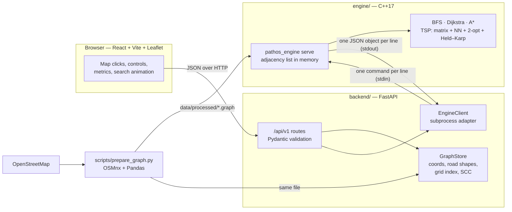
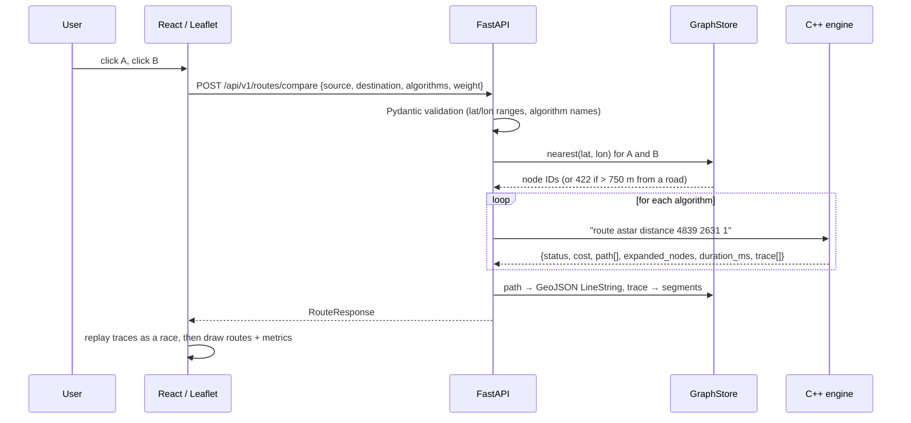
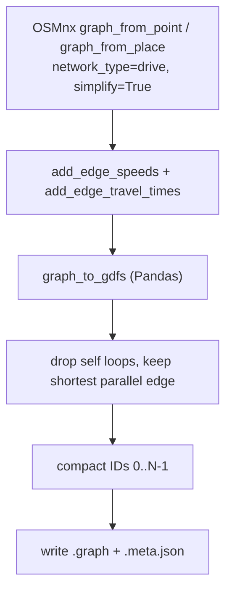
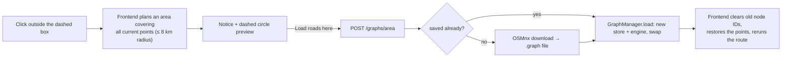

# Architecture

pathos is an interactive routing and multi-stop tour (TSP) visualizer on real OpenStreetMap roads.
Users click points on a map, compare **BFS**, **Dijkstra** and **A\*** side by side (route, running
time, expanded nodes, length) with an animated replay of each search, and plan a **multi-stop tour**
with nearest-neighbour + 2-opt.

This document describes the system **as implemented**. The original proposal lives in
[`INITIAL_ARCHITECTURE.md`](INITIAL_ARCHITECTURE.md); the differences are listed at the end.

## 1. System overview



| Layer | Location | Responsibility |
|---|---|---|
| Data preparation | `scripts/` | Download roads with OSMnx, keep one-way restrictions, add length + travel time, assign compact IDs, export the graph file |
| Routing engine | `engine/` | Store the directed graph as an adjacency list; run BFS, Dijkstra, A*, TSP; reconstruct paths; measure runtime / expanded nodes; record search events |
| API | `backend/` | Validate requests, snap coordinates to road nodes, call the engine, turn node IDs into GeoJSON geometry, report errors |
| Frontend | `frontend/` | Map, point selection, algorithm controls, comparison table, search-race animation, tour view |

**Design rule:** all graph algorithms run in C++. Python only validates, snaps and formats; React
only displays. The frontend never re-implements routing.

## 2. Request lifecycle (route comparison)



Search events are recorded **once**, during the real run, and replayed by the browser; the
algorithm is never re-run per animation frame.

## 3. C++ engine

```
engine/
├── include/pathos/
│   ├── types.hpp      Node, Edge, Weight, Algorithm, SearchEvent, RouteResult
│   ├── graph.hpp      Graph (adjacency list), haversine, admissible heuristic
│   ├── routing.hpp    bfs / dijkstra / astar / dijkstra_to_targets / path helpers
│   ├── tsp.hpp        Matrix, nearest_neighbor_tour, two_opt, held_karp, solve_tour
│   └── json.hpp       dependency-free JSON writer
├── src/               graph.cpp path.cpp bfs.cpp dijkstra.cpp astar.cpp tsp.cpp main.cpp
├── tests/test_engine.cpp
├── CMakeLists.txt
└── build.sh           CMake if available, otherwise plain c++
```

### Data structures

| Structure | Purpose |
|---|---|
| `std::vector<Node>` | Node table indexed by compact ID: lat, lon, original OSM ID |
| `std::vector<std::vector<Edge>>` | **Adjacency list** of outgoing directed edges (`to`, `length_m`, `time_s`) |
| `std::queue<NodeId>` | BFS frontier |
| `std::priority_queue` (binary min-heap) | Dijkstra / A* frontier, lazy deletion of stale entries |
| `parent[]`, `dist[]` / `gscore[]`, `settled[]` | Path reconstruction, best known cost, closed set |
| `std::vector<SearchEvent>` | `(node, parent)` per expansion, for the animation (capped at 400 000) |
| `Matrix` (k × k) | Shortest road cost between tour stops; asymmetric because of one-way streets |
| `dp[2^k][k]` | Held–Karp bitmask DP for the exact tour (k ≤ 12) |

One-way roads are directed edges that exist in one direction only; two-way roads are stored as two
edges. Parallel OSM edges between the same pair are reduced to the shortest one during preparation.

### Algorithms

| Algorithm | Objective | Complexity | Notes |
|---|---|---|---|
| BFS | fewest road segments | O(V + E) | Ignores length, so its route is usually longer in metres |
| Dijkstra | min Σ weight | O((V + E) log V) | Stops when the target is settled |
| A\* | min Σ weight | same worst case, far fewer expansions | `h = 0.999 × haversine` (distance) or `haversine / v_max` (time); both admissible and consistent, so A\* returns the same cost as Dijkstra |
| Distance matrix | k one-to-many Dijkstras | O(k (V + E) log V) | Each run stops once all k stops are settled; parent arrays are kept to rebuild legs |
| Nearest neighbour | initial tour | O(k²) | Starts at stop 0 |
| 2-opt | improve tour | O(k²) per pass | Best-improvement, stop 0 fixed. Works on **asymmetric** costs: reversing `t[i..k]` also reverses its inner legs, evaluated in O(1) with forward/backward prefix sums |
| Held–Karp | exact optimum | O(2^k k²) | Only for k ≤ 12, to report the heuristic's optimality gap |

Edge weight is selectable: `distance` (metres) or `time` (free-flow seconds from OSM speed limits,
imputed per road type by OSMnx). These are static estimates, **not** live traffic.

### Process interface

```
pathos_engine <graph-file> serve          # long-running; prints {"ok":true,"ready":true,...}
pathos_engine <graph-file> <command...>   # single command, useful for debugging

info
route <bfs|dijkstra|astar> <distance|time> <source> <target> [trace 0|1]
tour  <distance|time> <stop1> <stop2> ... <stopK>
quit
```

The API keeps one engine process alive, so the graph is parsed once. Calls are serialised with a
lock; if the process crashes or does not answer within the timeout, it is restarted and the call is
retried once.

## 4. Graph file format

Shared by the engine and the API (`scripts/graph_format.py`):

```
# comments
pathos-graph 1
version jaipur-v1
nodes N
<lat> <lon> <osm_id>                               # line i = node i
edges M
<u> <v> <length_m> <time_s> <k> [<lat> <lon>]*k    # directed u -> v; k road shape points
```

Shape points are used only for drawing curved roads; the engine skips them. A `<name>.meta.json`
sidecar stores the bbox, source query, OSMnx version and creation time so results can be tied to a
graph version.



`scripts/make_demo_graph.py` writes a synthetic city grid in the same format so the app works offline.

## 5. API layer

| Endpoint | Purpose |
|---|---|
| `POST /api/v1/routes` | One algorithm (`algorithm`, `weight`, `record_trace`) |
| `POST /api/v1/routes/compare` | Several algorithms on the same pair (default: all three) |
| `POST /api/v1/tours` | Multi-stop tour; first stop is start and end |
| `GET /api/v1/graph/metadata` | Active graph: version, size, bbox, limits |
| `GET /api/v1/graphs` | Map areas saved in `data/processed` |
| `POST /api/v1/graphs/select` | Switch to a saved map area (`{"name": "jaipur-v1"}`) |
| `POST /api/v1/graphs/area` | Download roads around `center` or a `place` within `radius_m`, save and activate them |
| `GET /api/v1/health` | Engine liveness |
| `GET /docs` | Interactive OpenAPI docs |

### Map areas (runtime graph switching)

`GraphManager` (`backend/app/services/graph_manager.py`) owns the active `GraphStore` + engine
pair. Switching builds the new store and starts a new engine process first, swaps them in under a
lock, and stops the old engine after a 30 s grace period, so in-flight requests finish on the graph
they started with. Each request takes one consistent snapshot of the pair.

`POST /graphs/area` calls `prepare_graph.build_graph()` (the same code as the CLI) to download a
circle of roads with OSMnx, writes `data/processed/<name>.graph`, and activates it. Names are
`area_<lat>_<lon>_<radius>m` or `<place-slug>-<radius>m`; an area that already exists is reused
without downloading. Only one download runs at a time (409 otherwise); the radius is capped at
`PATHOS_MAX_AREA_RADIUS_M` (8 km). Roads without a `maxspeed` tag get typical speeds per road type,
so rural areas with no speed tags still get travel times.



### Snapping

`GraphStore` indexes nodes in a uniform grid (~250 m cells) and searches rings of cells outward,
stopping once no closer node can exist. Points more than 750 m from any road are rejected with a
422 whose `detail` is structured:

```json
{ "code": "outside_coverage", "label": "source", "point": {"lat": 27.21063, "lon": 77.49784},
  "graph_version": "jaipur-v1", "distance_to_area_m": 169077,
  "message": "The source (27.21063, 77.49784) is about 169.1 km outside the loaded map area ('jaipur-v1'). Load the roads for this area first." }
```

The frontend uses it to offer loading that area instead of only showing an error. It also checks
clicks against the active bounding box before sending any request.

By default clicks only snap to nodes in the **largest strongly connected component**, computed at
start-up with an iterative **Kosaraju** algorithm (two DFS passes, O(V + E)). This guarantees that
any two snapped points are mutually reachable despite one-way streets. Set
`PATHOS_SNAP_MAIN_COMPONENT=0` to snap to any node instead; the engine then reports
`"status": "unreachable"` for impossible routes and lists unreachable tour legs explicitly (never as
zero-cost legs).

### Example

```json
POST /api/v1/routes/compare
{ "source": {"lat": 26.9124, "lon": 75.7873},
  "destination": {"lat": 26.9239, "lon": 75.8067},
  "algorithms": ["bfs", "dijkstra", "astar"], "weight": "distance", "record_trace": true }
```

Each result contains `status`, `cost`, `distance_m`, `time_s`, `segments`, `expanded_nodes`,
`duration_ms`, `route_node_ids`, a GeoJSON `geometry` (`[lon, lat]`), and `trace`: one
`[parent_lat, parent_lon, lat, lon]` entry per expanded node, in expansion order.

### Configuration (environment variables)

| Variable | Default |
|---|---|
| `PATHOS_GRAPH` | `data/processed/jaipur-v1.graph`, else `demo-v1.graph` |
| `PATHOS_ENGINE` | `engine/build/pathos_engine` |
| `PATHOS_MAX_TOUR_STOPS` | 25 |
| `PATHOS_MAX_SNAP_M` | 750 |
| `PATHOS_SNAP_MAIN_COMPONENT` | 1 |
| `PATHOS_ENGINE_TIMEOUT_S` | 30 |
| `PATHOS_MAX_TRACE_EVENTS` | 150 000 |
| `PATHOS_DATA_DIR` | `data/processed` |
| `PATHOS_OSM_CACHE` | `data/raw/osmnx-cache` |
| `PATHOS_MAX_AREA_RADIUS_M` | 8000 |

## 6. Frontend

```
frontend/src/
├── api/            typed client + response types (mirror backend schemas)
├── map/            MapController (imperative Leaflet), MapView (React wrapper)
├── components/     RoutePanel (controls, comparison table, insights), TourPanel
├── App.tsx         state, click handling, drawing
└── format.ts       units and algorithm colours
```

- **Compare routes:** click A then B; the comparison runs automatically. Search traces are replayed
  as a race (the same number of expansions per frame for every algorithm), so A\* visibly finishes
  first. Final routes are drawn stacked (BFS widest, A\* narrowest) so overlaps and divergences are
  visible.
- **Multi-stop tour:** click stops, then *Plan tour*. Shows the visiting order, nearest-neighbour
  vs 2-opt cost, the exact optimum and gap (≤ 12 stops), per-leg distances and the asymmetric
  shortest-path matrix. Unreachable legs are drawn as red dashed lines.
- The production build is served by FastAPI at `/`; in development Vite proxies `/api` to port 8000.

## 7. Error handling

| Scenario | Behaviour |
|---|---|
| Invalid coordinates / algorithm / weight | 422 from Pydantic |
| Point outside the loaded map | 422 `outside_coverage`; UI offers to download that area |
| Point inside the map but far from roads | 422 `outside_coverage` with `distance_to_area_m = 0`; shown as an error |
| Unknown place name | 404 |
| No drivable roads in the requested area | 422 |
| OpenStreetMap download fails / times out | 502; the current map stays active |
| Second download while one is running | 409 |
| Invalid saved-area name (e.g. `../x`) | 422; names are checked against `^[A-Za-z0-9][A-Za-z0-9_.-]*$` |
| Source = destination | `success`, zero cost, single-node path |
| Destination unreachable | `status: "unreachable"`, `geometry: null`, `cost: null` |
| One-way restriction | Directed edges only; never traversed backwards |
| Unreachable tour stop | `status: "unreachable"`, `unreachable_legs` listed, red dashed leg in the UI |
| Too many / too few stops | 422 (limit 25, minimum 2) |
| Large trace | Capped (`trace_truncated: true`) |
| Engine crash / hang | Restart + one retry, then 503 and server-side log |

## 8. Testing

| Level | Command | Covers |
|---|---|---|
| Engine unit tests | `engine/build/pathos_tests` | Known shortest paths, one-way edges, unreachable nodes, source = target, trace capping, Dijkstra = A\* on 400 random queries (distance and time), BFS ≤ Dijkstra in segments, NN/2-opt permutations and non-increasing cost, asymmetric 2-opt, Held–Karp ≤ heuristic, tours with unreachable stops |
| Sanitizers | build with `-DPATHOS_SANITIZE=ON` | AddressSanitizer + UBSan on the unit tests |
| API integration | `cd backend && ../.venv/bin/pytest` | FastAPI → real engine subprocess on a hand-made graph: comparison, one-way, unreachable, snapping, structured outside-coverage errors, validation, tours, limits, SCC snapping, Kosaraju, crash recovery, listing/selecting/downloading map areas (download faked) |
| Frontend | `cd frontend && npm run build` | TypeScript type-check + production build |

## 9. Repository layout

```
pathos/
├── engine/          C++ routing engine (CMake)
├── backend/         FastAPI app (app/main.py, routes/, schemas/, services/) + tests/
├── frontend/        React + Vite + TypeScript + Leaflet (AreaPanel = map-area switcher)
├── scripts/         prepare_graph.py (OSMnx), make_demo_graph.py, graph_format.py
├── data/processed/  versioned graph files (+ .meta.json); data/raw/ is the OSMnx cache
├── algos/           standalone reference implementations and notes (grid A*, bitmask TSP,
│                    nearest neighbour, 2-opt on points) used while designing the engine
├── docs/            project proposal (pathos.pdf)
└── run.sh           build everything and start the server
```

## 10. Changes from the initial architecture

| Initial plan | Implemented | Why |
|---|---|---|
| Snapping inside the API | Kept, plus restricting snaps to the largest SCC (Kosaraju) | Clicks on one-way stubs produced unreachable routes in real Jaipur data |
| CLI subprocess per request | One persistent `serve` process with a line protocol | The graph is parsed once instead of on every request |
| Trace ID + streaming for large traces | Inline trace with a cap and `trace_truncated` flag | City-scale graphs (thousands of nodes) give traces of a few hundred KB; streaming was unnecessary |
| Symmetric 2-opt | Asymmetric 2-opt with prefix sums and a fixed start | One-way streets make `D[i][j] ≠ D[j][i]` |
| — | Held–Karp exact tour for ≤ 12 stops | To measure how close the heuristic gets |
| One pre-built city graph | Any area can be downloaded and switched to at runtime | Users clicked outside Jaipur (e.g. near Bharatpur) and only got an error |
| D3.js / Mapbox GL animation | Leaflet canvas renderer | Enough for thousands of animated segments, one fewer dependency |
| Saved experiments (SQLite), road closures, alternative routes, Docker Compose, pybind11 | Not implemented | Optional extensions; the API and engine protocol leave room for them |
