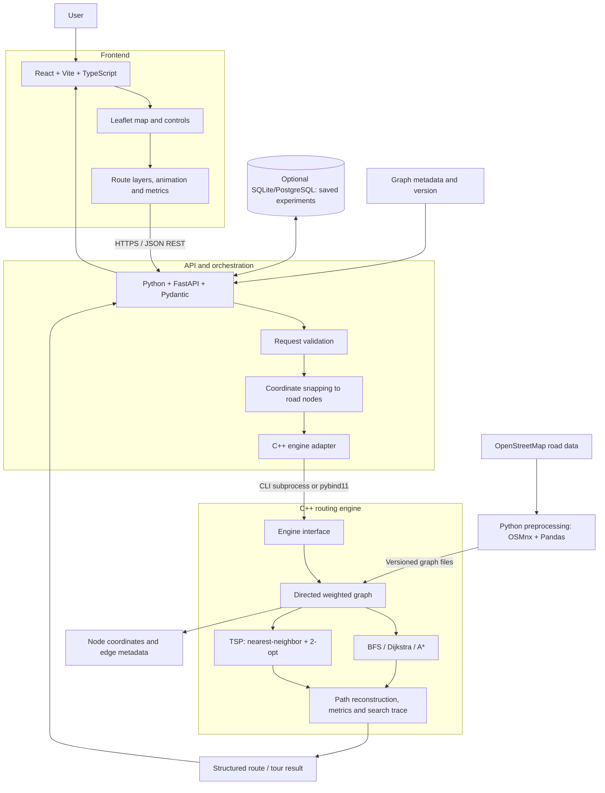
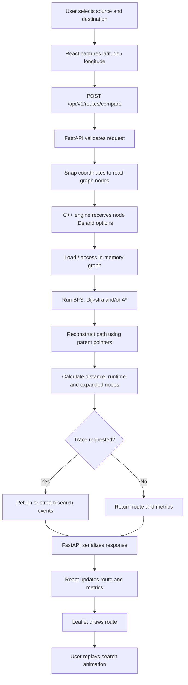
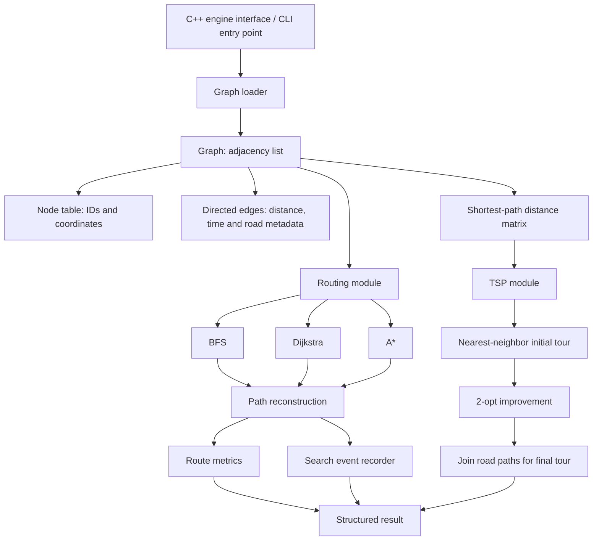
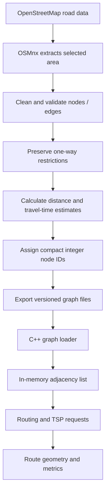
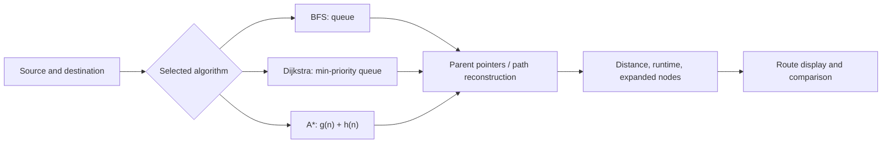
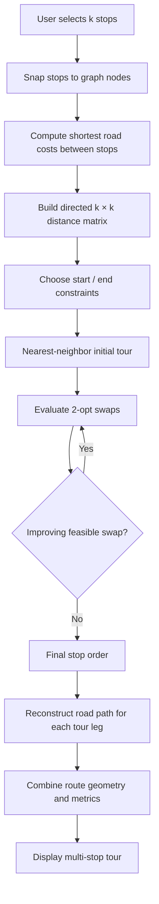
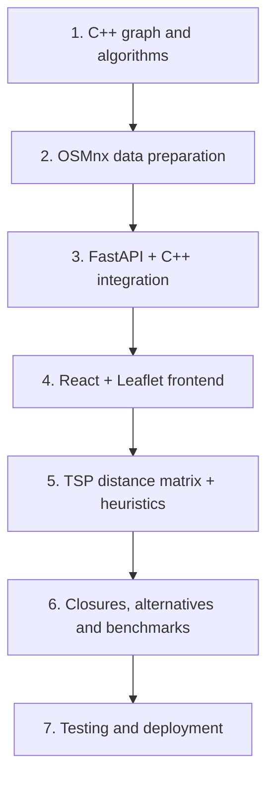

# Pathos — End-to-End System Architecture

> **Pathos:** “Fewer wrong turns, more right answers.”  
> **Course:** CSL 2120 — Data Structures & Algorithms  
> **Core stack:** C++ for graph algorithms, Python/FastAPI for API orchestration, React + Leaflet for the interface.

This document uses **only architecture and pipeline graphs**—no decorative or stock images. All diagrams are Mermaid graphs embedded directly in this Markdown file, so there are no external image paths or missing local assets.

## 1. Project overview

Pathos is an interactive urban-routing and Traveling Salesperson Problem (TSP) visualizer built around OpenStreetMap road networks. Users select locations, choose algorithms, compare routes, and replay search exploration. For multiple stops, the system constructs a tour with nearest-neighbor and improves it using 2-opt.

Core algorithms:
- **BFS:** finds a route with the fewest edges, not necessarily the shortest distance.
- **Dijkstra:** shortest path for nonnegative edge weights.
- **A\*:** heuristic-guided shortest path with a suitable admissible heuristic.
- **TSP heuristic:** nearest-neighbor followed by 2-opt; approximate, not guaranteed globally optimal.

## 2. Complete end-to-end system architecture



### Layer responsibilities

| Layer | Technology | Responsibilities |
|---|---|---|
| Frontend | React + Vite + TypeScript | Location selection, algorithm controls, route layers, animation and metrics |
| Map | Leaflet.js | Map tiles, markers, waypoints and route polylines |
| API | Python + FastAPI + Pydantic | Validation, snapping, engine invocation, response formatting and error handling |
| Native engine | C++17/20 + CMake | Graph storage, BFS, Dijkstra, A*, TSP, path reconstruction and instrumentation |
| Data preparation | Python + OSMnx + Pandas | Extract road data, preserve direction restrictions, compute edge weights and export graph |
| Storage | Versioned graph files; optional SQLite/PostgreSQL | Graph snapshots, metadata and saved experiments |
| Testing/deployment | C++ tests, pytest, frontend tests, Docker Compose | Correctness, integration and reproducible deployment |

**Design principle:** C++ runs the algorithms. FastAPI coordinates requests; React displays results. The frontend should not reimplement routing logic.

## 3. Request lifecycle pipeline



1. The user selects source and destination on the map.
2. React sends coordinates and options as JSON.
3. FastAPI validates the input and snaps each coordinate to a valid road node.
4. The C++ engine runs the selected algorithm.
5. The engine reconstructs the route and calculates metrics.
6. Optional search events are returned for animation.
7. FastAPI serializes the result.
8. React and Leaflet display the route, comparisons and replay controls.

Record search events during the algorithm run. Do not rerun the algorithm for every animation frame. For large traces, return a trace ID and stream or paginate events.

## 4. Internal C++ engine architecture



### Suggested C++ source tree

```text
pathos/
├── frontend/
│   └── src/
│       ├── components/
│       ├── map/
│       ├── algorithms/
│       └── api/
├── backend/
│   └── app/
│       ├── main.py
│       ├── routes/
│       ├── schemas/
│       └── services/
├── engine/
│   ├── include/pathos/
│   │   ├── graph.hpp
│   │   ├── routing.hpp
│   │   ├── tsp.hpp
│   │   └── types.hpp
│   ├── src/
│   │   ├── graph.cpp
│   │   ├── bfs.cpp
│   │   ├── dijkstra.cpp
│   │   ├── astar.cpp
│   │   ├── tsp.cpp
│   │   └── main.cpp
│   ├── tests/
│   └── CMakeLists.txt
├── scripts/
│   └── prepare_graph.py
├── data/
│   ├── raw/
│   └── processed/
├── docs/
└── docker-compose.yml
```

### Core data structures

| Structure | Purpose |
|---|---|
| `Node` | Integer ID, latitude and longitude |
| `Edge` | Destination, distance, estimated travel time and road metadata |
| `Graph` | Adjacency list of outgoing directed edges |
| `priority_queue` | Frontier for Dijkstra and A* |
| `parent[]` | Path reconstruction |
| `distance[]` | Best-known cost from source |
| `visited[]` / closed set | Track expanded nodes |
| `DistanceMatrix` | Shortest-path costs between TSP stops |
| `SearchEvent[]` | Search events for UI animation |

Represent one-way roads as directed edges. For two-way roads, store each permitted direction explicitly; directional costs may differ.

## 5. Road-data preparation pipeline



Preprocess road data outside the interactive request path. Store the graph version with each experiment so benchmark results can be reproduced.

## 6. Algorithm pipeline and key properties



- **BFS:** `O(V + E)`; minimizes edge count, not physical distance.
- **Dijkstra:** with a binary heap, typically `O((V + E) log V)`; minimizes nonnegative weighted cost.
- **A\*:** ranks nodes by `f(n) = g(n) + h(n)`; optimal with suitable heuristic assumptions. For distance routing, straight-line geographic distance is a lower bound when edge lengths are consistent with it.
- Use consistent weight definitions when comparing Dijkstra and A*. For time-based routing, use a compatible lower-bound time heuristic.

## 7. TSP multi-stop tour pipeline



With one-way roads, `D[i][j]` can differ from `D[j][i]`. Mark unreachable pairs explicitly rather than treating them as zero-cost legs. Nearest-neighbor plus 2-opt is an approximation and does not guarantee the globally optimal tour.

## 8. API contract

| Endpoint | Purpose |
|---|---|
| `POST /api/v1/routes` | Find one route |
| `POST /api/v1/routes/compare` | Compare BFS, Dijkstra and A* |
| `POST /api/v1/tours` | Compute a multi-stop tour |
| `GET /api/v1/graph/metadata` | Graph size, coverage and version |
| `GET /api/v1/health` | Service health check |
| `GET /api/v1/experiments/{id}` | Retrieve a saved experiment (optional) |

### Example request

```json
{
  "source": { "lat": 26.9124, "lon": 75.7873 },
  "destination": { "lat": 26.9239, "lon": 75.8267 },
  "algorithms": ["bfs", "dijkstra", "astar"],
  "weight": "distance",
  "record_trace": true
}
```

The coordinates are illustrative, around Jaipur; they do not assert that a particular road path is available.

### Example response shape

```json
{
  "graph_version": "jaipur-v1",
  "results": [
    {
      "algorithm": "astar",
      "status": "success",
      "distance_m": 4200,
      "duration_ms": 8.3,
      "expanded_nodes": 152,
      "route_node_ids": [101, 104, 117],
      "geometry": {
        "type": "LineString",
        "coordinates": [
          [75.7873, 26.9124],
          [75.8010, 26.9170],
          [75.8267, 26.9239]
        ]
      },
      "trace_id": "example-trace-id"
    }
  ]
}
```

The values above are examples, not measured results. In production, geometry and metrics must be generated from the loaded graph and actual algorithm execution.

## 9. Additional functionality

Prioritize useful graph/algorithm extensions:

1. **Algorithm laboratory:** compare route cost, expanded nodes and runtime across multiple trials.
2. **Road closures:** block an edge and rerun routing; compare before/after results.
3. **Alternative routes:** show alternatives and trade-offs; consider Yen's K-shortest loopless paths as an advanced extension.
4. **Turn-by-turn directions:** use road names and geometry to generate readable instructions.
5. **Saved experiments:** persist input points, algorithm settings, graph version and metrics.

Do not describe static estimated edge weights as live traffic. A real-time traffic feature requires a reliable traffic data source.

## 10. Error handling and testing

| Scenario | Expected behavior |
|---|---|
| Invalid coordinates | Validation error |
| Source equals destination | Zero-cost route |
| Destination unreachable | Explicit `unreachable` status |
| One-way restriction | Never traverse against permitted direction |
| Blocked edge | Exclude from applicable search |
| Too many TSP stops | Enforce stop limit or time budget |
| Large search trace | Stream or paginate events |
| C++ process failure | Controlled API error and server-side logging |

Testing levels:
1. **Unit tests:** known shortest paths, disconnected graphs and directed edges.
2. **Algorithm tests:** BFS minimizes edge count; Dijkstra and A* agree on optimal weighted cost under suitable assumptions.
3. **TSP tests:** valid stop order, feasible legs and non-increasing accepted 2-opt objective.
4. **Integration tests:** FastAPI-to-C++ invocation and response schema.
5. **Frontend tests:** location selection, route rendering, animation and error states.

Use CMake for repeatable builds, AddressSanitizer during development and GitHub Actions for automated tests. Benchmark optimized builds over multiple trials.

## 11. Implementation roadmap



1. Build the graph representation, BFS, Dijkstra, A* and path reconstruction; test on synthetic graphs.
2. Prepare a real road graph with directed edges, weights and coordinates.
3. Add FastAPI validation, coordinate snapping and a C++ subprocess adapter.
4. Build map selection, route rendering, algorithm controls and metrics.
5. Add the TSP distance matrix, nearest-neighbor and 2-opt.
6. Add road closures, alternative routes, saved experiments and benchmarking.
7. Add integration tests, deployment configuration, logging and documentation.

## 12. Final recommended stack

| Layer | Choice |
|---|---|
| Frontend | React + Vite + TypeScript |
| Map | Leaflet.js |
| Animation/charts | D3.js or a custom event renderer |
| API | Python + FastAPI + Pydantic |
| Algorithms | C++17/20 |
| Build | CMake |
| Integration | CLI subprocess first; `pybind11` later if needed |
| Road data | OpenStreetMap + OSMnx + Pandas |
| Persistence | SQLite initially |
| Testing | C++ unit tests + pytest + frontend tests |
| Deployment | Docker Compose |

## 13. First working milestone

**Real map → select two locations → FastAPI validates and snaps → C++ computes route → API returns geometry and metrics → Leaflet renders and animates it.**

Complete this end-to-end flow first, then add TSP, benchmarking, road closures and alternative routes.
