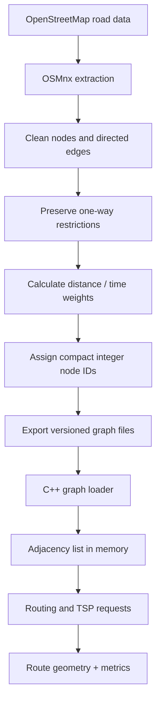

# Pathos — End-to-End System Architecture

> **Pathos: “Fewer wrong turns, more right answers.”**  
> CSL 2120 — Data Structures & Algorithms  
> **Core design:** C++ for graph algorithms and routing; Python/FastAPI for API orchestration; React + Leaflet for the interactive map.

## 1. Project overview

Pathos is an interactive urban-routing and Traveling Salesperson Problem (TSP) visualizer built around real road networks from OpenStreetMap. Users select locations, choose routing algorithms, view routes and replay search exploration. For multiple stops, the system builds a short tour using nearest-neighbor and improves it with 2-opt.

The baseline algorithms are:
- **BFS:** fewest road segments (unweighted edge count), not shortest physical distance.
- **Dijkstra:** shortest path under nonnegative edge weights.
- **A\*:** shortest path with a suitable admissible heuristic.
- **TSP heuristic:** nearest-neighbor initial tour followed by 2-opt improvement; this is an approximation, not a guarantee of global optimality.

## 2. Complete system architecture


### Layers and responsibilities

| Layer | Technology | Responsibilities |
|---|---|---|
| Frontend | React + Vite + TypeScript | Map controls, location selection, route layers, search replay, metrics dashboard |
| Map | Leaflet.js | Display tiles, markers, route polylines, waypoints and blocked edges |
| API | Python + FastAPI + Pydantic | Validate requests, snap coordinates, call engine, format responses and handle errors |
| Native engine | C++17/20 + CMake | Graph storage, BFS, Dijkstra, A*, path reconstruction, TSP, benchmark instrumentation |
| Data preparation | Python + OSMnx + Pandas | Download/extract road graph, clean data, preserve one-way roads, calculate edge weights, export graph |
| Storage | Versioned graph files; optional SQLite/PostgreSQL | Graph snapshots, metadata, saved experiments and route history |
| Tests/operations | C++ tests, pytest, frontend tests, Docker Compose | Correctness, integration, reproducible builds, deployment and monitoring |

**Design principle:** C++ performs the algorithms. FastAPI coordinates requests and the frontend visualizes results; neither should reimplement the core routing algorithms.

## 3. Request lifecycle


1. The user selects a source and destination on the Leaflet map.
2. React sends coordinates and options to FastAPI using JSON.
3. FastAPI validates the request and snaps each coordinate to a suitable road-graph node.
4. The engine runs BFS, Dijkstra, A*, or the requested comparison.
5. C++ reconstructs the route using predecessor/parent pointers.
6. The engine records distance, elapsed time, expanded-node count and optional search events.
7. FastAPI serializes the result and returns it to the browser.
8. React draws the route and can replay the recorded search trace.

Record search events during the algorithm run; do not rerun the algorithm on every animation frame. For large traces, use a trace ID and stream or paginate events rather than returning a huge JSON payload.

## 4. Internal C++ engine


### Suggested source tree

```text
pathos/
├── frontend/
│   └── src/
│       ├── components/
│       ├── map/
│       ├── algorithms/
│       └── api/
├── backend/
│   └── app/
│       ├── main.py
│       ├── routes/
│       ├── schemas/
│       └── services/
├── engine/
│   ├── include/pathos/
│   │   ├── graph.hpp
│   │   ├── routing.hpp
│   │   ├── tsp.hpp
│   │   └── types.hpp
│   ├── src/
│   │   ├── graph.cpp
│   │   ├── bfs.cpp
│   │   ├── dijkstra.cpp
│   │   ├── astar.cpp
│   │   ├── tsp.cpp
│   │   └── main.cpp
│   ├── tests/
│   └── CMakeLists.txt
├── scripts/
│   └── prepare_graph.py
├── data/
│   ├── raw/
│   └── processed/
├── docs/
└── docker-compose.yml
```

### Important data structures

| Structure | Purpose |
|---|---|
| `Node` | Integer node ID, latitude and longitude |
| `Edge` | Destination ID, distance, travel-time estimate and road metadata |
| `Graph` | Adjacency list of outgoing directed edges |
| `priority_queue` | Min-priority queue for Dijkstra and A* |
| `parent[]` | Reconstructs a route from destination to source |
| `distance[]` | Best-known path cost to each node |
| `visited[]` / closed set | Tracks expanded or processed nodes |
| `DistanceMatrix` | Shortest-path costs between TSP stops |
| `SearchEvent[]` | Events used to animate exploration in the UI |

One-way roads must be represented as directed edges. For a two-way road, store the permitted directions explicitly; costs may differ by direction.

## 5. Algorithms and correctness

### BFS
- Uses a FIFO queue.
- Finds the path with the fewest edges.
- Complexity: `O(V + E)`.
- It does **not** minimize road distance when edge lengths differ.

### Dijkstra
- Uses a min-priority queue.
- Finds a minimum-cost route when edge weights are nonnegative.
- With a binary heap, typical complexity is `O((V + E) log V)`.

### A*
- Prioritizes nodes using `f(n) = g(n) + h(n)`.
- `g(n)` is the cost from the source; `h(n)` estimates the remaining cost.
- For distance routing, straight-line geographic distance is a useful admissible heuristic when road-edge distances respect that lower bound.
- For travel-time routing, use a compatible lower-bound time heuristic.

### TSP
1. Compute shortest road-path costs between selected stops.
2. Build a directed `k × k` distance matrix.
3. Build an initial tour using nearest-neighbor.
4. Try 2-opt swaps to reduce tour cost.
5. Reconstruct and join road paths between consecutive stops.

For one-way roads, `D[i][j]` can differ from `D[j][i]`. Mark unreachable pairs explicitly; never treat them as zero-cost legs. The heuristic does not guarantee the globally optimal tour.

## 6. API contract

| Endpoint | Purpose |
|---|---|
| `POST /api/v1/routes` | Find a route using one algorithm |
| `POST /api/v1/routes/compare` | Compare BFS, Dijkstra and A* |
| `POST /api/v1/tours` | Compute a multi-stop tour |
| `GET /api/v1/graph/metadata` | Graph size, coverage and graph version |
| `GET /api/v1/health` | Health check |
| `GET /api/v1/experiments/{id}` | Retrieve a saved experiment (optional persistence feature) |

### Example request

```json
{
  "source": { "lat": 26.9124, "lon": 75.7873 },
  "destination": { "lat": 26.9239, "lon": 75.8267 },
  "algorithms": ["bfs", "dijkstra", "astar"],
  "weight": "distance",
  "record_trace": true
}
```

Coordinates are illustrative, around Jaipur; they do not imply that a particular road path is available.

### Example response shape

```json
{
  "graph_version": "jaipur-v1",
  "results": [
    {
      "algorithm": "astar",
      "status": "success",
      "distance_m": 4200,
      "duration_ms": 8.3,
      "expanded_nodes": 152,
      "route_node_ids": [101, 104, 117],
      "geometry": {
        "type": "LineString",
        "coordinates": [
          [75.7873, 26.9124],
          [75.8010, 26.9170],
          [75.8267, 26.9239]
        ]
      },
      "trace_id": "example-trace-id"
    }
  ]
}
```

All response values are examples, not measured results. In the implementation, geometry and metrics must be generated from the loaded graph and actual algorithm execution.

## 7. Data preparation pipeline



Preprocess map data separately from interactive route requests. Store graph version information with benchmarks so results from different road-network snapshots are not compared as if they were identical.

## 8. Additional functionality to make the project stronger


*Illustrative outdoor/urban exploration visual; not a screenshot of the Pathos application.*

### Priority 1 — Algorithm laboratory
- Compare route cost, expanded nodes and runtime.
- Run repeated trials over different source/destination pairs.
- Show distributions or medians, not just a single timing.
- Verify Dijkstra and A* return equal optimal costs on the same weighted graph.

### Priority 2 — Road closures and blocked edges
- Let users block a road segment.
- Recompute the route without that edge.
- Compare before/after path cost and explored nodes.
- Keep closures request-specific unless the user explicitly saves them.

### Priority 3 — Alternative routes
- Show alternative routes and their trade-offs.
- Later, implement Yen's K-shortest loopless paths algorithm if time permits.

### Priority 4 — Turn-by-turn directions
- Use OpenStreetMap road names and turn geometry to generate readable instructions.
- This is additional logic beyond graph path reconstruction.

### Priority 5 — Saved experiments
- Save source/destination, algorithm options, graph version, results and metrics.
- SQLite is enough for a student project; PostgreSQL is optional for multi-user deployment.

Avoid claiming live traffic unless a reliable live traffic source is integrated. Static edge weights are estimates, not real-time conditions.

## 9. Error handling and testing

| Scenario | Expected behavior |
|---|---|
| Invalid coordinates | Validation error |
| Source equals destination | Zero-cost route |
| Destination unreachable | Explicit `unreachable` status |
| One-way road | Never traverse against direction |
| Blocked edge | Exclude from the relevant search |
| Too many TSP stops | Enforce a configured limit or time budget |
| Huge search trace | Stream or paginate events |
| C++ process failure | Controlled API error; log details server-side |

Testing plan:
1. **Unit tests:** small graphs with known shortest paths, disconnected components, and directed edges.
2. **Algorithm tests:** BFS minimizes edge count; Dijkstra and A* agree on optimal weighted costs under suitable assumptions.
3. **TSP tests:** validate stop permutations, route feasibility, and that accepted 2-opt changes do not increase the objective.
4. **Integration tests:** verify FastAPI-to-C++ invocation and response schema.
5. **Frontend tests:** map selection, route rendering, trace playback and error states.

Use CMake for repeatable builds, AddressSanitizer during development, and GitHub Actions for automated tests. Benchmark in release builds and use multiple trials.

## 10. Implementation roadmap

1. **C++ graph + algorithms:** graph representation, BFS, Dijkstra, A*, path reconstruction and unit tests.
2. **Real road data:** OSMnx preprocessing, directed edges, weights, node coordinates and graph export.
3. **API integration:** FastAPI validation, snapping and C++ subprocess adapter.
4. **Frontend:** React, Leaflet, map selection, route layers, algorithm selector and metrics.
5. **TSP:** distance matrix, nearest-neighbor, 2-opt and multi-stop rendering.
6. **Advanced features:** blocked edges, alternative routes, saved experiments and benchmarking.
7. **Deployment:** Docker Compose, logging, error handling and documentation.

## 11. Final recommended stack

| Layer | Choice |
|---|---|
| Frontend | React + Vite + TypeScript |
| Map | Leaflet.js |
| Animation/charts | D3.js or custom event renderer |
| API | Python + FastAPI + Pydantic |
| Algorithms | C++17/20 |
| Build | CMake |
| Integration | CLI subprocess first; `pybind11` later if needed |
| Road data | OpenStreetMap + OSMnx + Pandas |
| Persistence | SQLite initially |
| Testing | C++ unit tests + pytest + frontend tests |
| Deployment | Docker Compose |

## 12. Recommended milestone

Build one complete working path first:

**Real map → user selects two locations → FastAPI validates and snaps → C++ computes the route → API returns geometry and metrics → Leaflet renders and animates it.**

Then add TSP, benchmarking, road closures and alternative routes. This sequence gives you a working demonstration early and keeps the core DSA work substantial.
